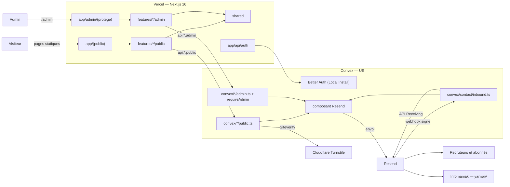
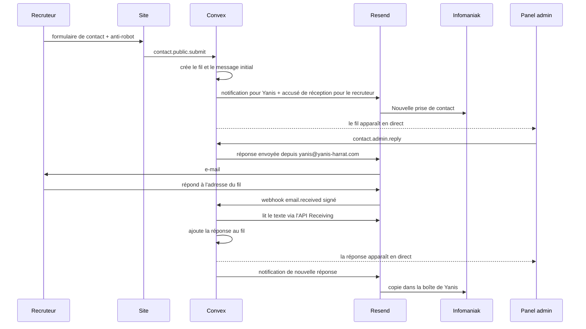

# INSTALL.md — Portfolio Yanis Harrat

Vision technique et guide d'installation. **Document de référence** : une décision qui le contredit doit d'abord le modifier, avec accord.

- **Statut** : validé par Yanis le 15/10/2026
- **Cadrage** : 15/10/2026 (`aidd-context:01-bootstrap`)
- **Vérifications** : doc officielle et code source des paquets, au 15/10/2026

## Vision

> Le portfolio d'un étudiant BTS SIO SISR (parcours, projets, épreuves, veille technologique) avec un contact direct pour les recruteurs et le jury.

Site vitrine personnel sur `yanis-harrat.com`, rapide et bien référencé. Un espace admin privé (un seul compte) permet de suivre chaque prise de contact comme un fil de conversation et d'envoyer la veille aux abonnés. Pas de couche de sécurité maison, conformité RGPD, recommandations ANSSI comme référentiel volontaire.

**Périmètre v1**

- Pages publiques : accueil, parcours, projets, épreuves, contact (avec lien Cal.com), veille.
- Contact : formulaire → fil de conversation dans l'admin + notification dans Infomaniak. Réponse depuis l'admin. Les réponses du recruteur reviennent dans le fil et sont notifiées dans Infomaniak.
- Veille : inscription en double opt-in, désinscription en un clic, rédaction et envoi groupé depuis l'admin.
- Admin : mot de passe puis TOTP, **ou** passkey seule.
- Hors v1 : pièces jointes entrantes (seuls les noms sont affichés), plusieurs comptes, app native, mode hors ligne, suivi d'ouverture des e-mails.

**Contraintes**

| Contrainte | Valeur |
| --- | --- |
| Public | Recruteurs et jury BTS, < 5 000 visiteurs/mois |
| Plateforme | Web responsive (mobile + desktop), pas d'app native |
| Données | RGPD. ANSSI = référentiel volontaire. NIS2 non applicable (site personnel) |
| Performance réelle (p75, mobile **et** desktop) | LCP ≤ 2,0 s · INP ≤ 150 ms · CLS ≤ 0,05 (seuils Google : 2,5 s · 200 ms · 0,1) |
| Lighthouse mobile | Performance ≥ 95 · SEO 100 · Accessibilité 100 · Bonnes pratiques 100 |
| Budget | 0 € (plans gratuits). Passage au payant seulement si une limite est atteinte |
| Équipe | 1 développeur, TypeScript/React débutant avancé : code explicite, aucune abstraction « magique » |

## Decisions

| Décision | Choix | Pourquoi |
| --- | --- | --- |
| Architecture | Monolithe modulaire **par feature × rôle** (public / admin) | 1 développeur, faible volume. Les rôles se lisent dans les routes, les écrans et le backend |
| Front-end | Next.js 16 (App Router) + Tailwind CSS v4. Pages publiques statiques | SEO et Core Web Vitals |
| UI | **shadcn/ui obligatoire** pour toutes les primitives. Les composants custom encapsulent une primitive et ne la modifient jamais | Règle projet du 15/10/2026. Composants accessibles, code copié dans le dépôt donc lisible |
| Back-end | Convex (TypeScript), un dossier par feature, fichiers `public.ts` / `admin.ts` | Admin en temps réel sans code en plus, aucun serveur à gérer |
| Base de données | Convex, région UE `aws-eu-west-1` (Dublin) | RGPD. Disponible en plan gratuit |
| Auth | Better Auth via `@convex-dev/better-auth` en **Local Install** : mot de passe → TOTP (+ codes de secours), **ou** passkey seule avec vérification de l'utilisateur obligatoire | Plugins officiels uniquement. Better Auth ne propose pas « passkey puis TOTP » sans code maison. La passkey est déjà un facteur multiple |
| E-mails | **Envoi** : `@convex-dev/resend` uniquement. **Réception** : Resend Receiving uniquement (webhook signé + SDK officiel `resend`) | Le composant ne sait pas recevoir. Exception stricte validée le 15/10/2026 |
| Anti-robot | Cloudflare Turnstile, jeton vérifié dans Convex | Protège le quota Resend (100/jour) et la réputation du domaine |
| Mesure | Vercel Web Analytics + Speed Insights (sans cookie), liens `?utm_source=veille`. Suivi Resend **désactivé** | CNIL 2026 : un pixel de suivi exige un consentement préalable, et le suivi Resend se règle par domaine |
| Hébergement | Vercel Hobby + Convex Free (UE) + Resend Free + Cloudflare (DNS, Turnstile). Infomaniak reste la boîte mail | 0 € |
| Environnements | Local · Preview par PR · Production sur `main`. **Un backend Convex par environnement** | Jamais deux écrivains sur un même backend |
| Paquets | pnpm | Rapide, verrouillage strict, déjà installé |
| Tests | Vitest (unitaire) + convex-test (intégration backend) + Playwright/axe (E2E, **sur le poste**) + Lighthouse CI (**à chaque PR**, sur la preview) | L'intégration backend protège les vraies règles. Les E2E locaux restent simples pour apprendre. Lighthouse garde les seuils SEO et performance sous contrôle |

## Stack summary

Versions relevées sur npm le 15/10/2026. Au scaffold, on installe la dernière version du même majeur.

- **Front-end** : `next` 16.4.x (Node ≥ 20.9 ; Vercel : Node 24.x), `react` 19.x, `tailwindcss` 4.3.x + `@tailwindcss/postcss` + `postcss`
- **UI** : shadcn/ui via la CLI `shadcn` 4.x (`pnpm dlx shadcn@latest init`, puis `add <composant>`). Tailwind v4 pris en charge (`tailwind.config` laissé vide dans `components.json`). L'`init` installe ses dépendances et l'utilitaire `cn`. **Choix irréversibles après `init`, faits au scope Design system** : bibliothèque de base (`radix`, `base` ou `aria`), style, couleur de base, variables CSS (oui par défaut).
- **Animations (pressenties, à trancher au scope Design system)** : Motion (ex-Framer Motion, paquet `motion` 14.x, import `motion/react`) et GSAP 3.x (+ `@gsap/react`, licence « standard no charge »). Garde-fous :
  - `prefers-reduced-motion` toujours respecté ;
  - chargement différé, pour ne pas dégrader le LCP et l'INP ciblés ;
  - Motion et GSAP se recoupent : chacun doit justifier son usage, sinon un seul est gardé.
- **Back-end / BDD** : `convex` ≥ 1.46
- **Auth** : `@convex-dev/better-auth` 0.12.x + `better-auth` **1.6.x** (le composant exige `>=1.6.11 <1.7.0`) + `@better-auth/passkey` 1.6.x (même version que `better-auth`)
- **E-mails** : `@convex-dev/resend` 0.2.x (envoi) + `resend` 6.x (réception uniquement)
- **Anti-robot** : script officiel Turnstile chargé depuis Cloudflare, sans paquet tiers
- **Mesure** : `@vercel/analytics` 2.x + `@vercel/speed-insights` 2.x
- **Tests** : `vitest` (5.x publiée ; la doc `convex-test` documente Vitest 3 et 4, compatibilité à vérifier), `convex-test` 0.0.x + `@edge-runtime/vm`, `@playwright/test` 1.x + `@axe-core/playwright` 4.x, `@lhci/cli` 0.15.x
- **Hébergement** : Vercel (projet `portfolio`, équipe `yanis-harrat`), Convex Cloud (projet en UE), Resend (domaines `yanis-harrat.com` + `reply.yanis-harrat.com`), Cloudflare (zone `yanis-harrat.com`)

## Architecture



`src/app` choisit **quelle page à quelle URL**, `src/features` décide **ce qu'on voit et ce qu'on fait**, `convex/` gère **les données et qui a le droit**. Le front n'appelle le backend que par `api.*`. Les secrets restent uniquement dans Convex. Le seul code hors Convex côté serveur est le relais `/api/auth` du composant Better Auth.

**Isolation des rôles, à trois niveaux**

1. **URL** : tout ce qui est sous `app/admin/(protege)/` passe par un `layout.tsx` qui vérifie la session côté serveur. `/admin/connexion` est la seule page admin ouverte. `robots.ts` bloque `/admin`.
2. **Écrans** : `features/x/public/` et `features/x/admin/` ne s'importent jamais l'un l'autre. Une feature à un seul rôle (`auth`) n'a pas de sous-dossier de rôle.
3. **Backend (la vraie barrière)** : un `public.ts` est ouvert à tous, donc il valide chaque argument et vérifie Turnstile. Toute fonction d'un `admin.ts` commence par `await requireAdmin(ctx)`, qui exige une session **et** l'e-mail du propriétaire (`yanis@yanis-harrat.com`). Un compte créé par quelqu'un d'autre n'aurait donc aucun droit. Le rôle se lit dans le nom : `api.contact.public.submit`, `api.contact.admin.reply`.

**Règles d'import** (non respectées = refus en revue)

1. `app/` importe uniquement depuis le `index.ts` d'une feature.
2. Une feature n'importe jamais les fichiers internes d'une autre feature.
3. `shared/` n'importe aucune feature.
4. `public/` n'importe jamais `admin/`, et inversement.
5. Le front appelle le backend uniquement par `api.*`, jamais par import d'un fichier `convex/`.

**Règles UI : shadcn/ui obligatoire**

1. Toute primitive UI (Button, Dialog, Input, etc.) vient de shadcn/ui, ajoutée par `shadcn add`. On n'écrit jamais une primitive à la main.
2. Un composant custom est construit à partir de composants shadcn/ui.
3. Une couche perso (variante, comportement, habillage) vit dans un composant custom qui **encapsule** la primitive : générique dans `src/shared/components/`, propre à une feature dans la feature.
4. Les fichiers de primitives générés (`src/shared/ui/*`) ne sont **jamais modifiés** à la main.

**Flux de contact de bout en bout**



- Tout mail adressé au recruteur part de `Yanis Harrat <yanis@yanis-harrat.com>`, avec une adresse de réponse **propre au fil** : `c-<id>@reply.yanis-harrat.com`. Le sous-domaine `reply.` a son MX chez Resend (réception sur toutes les adresses du domaine). La racine reste chez Infomaniak.
- Réception : signature du webhook vérifiée, mail accepté **seulement** si l'adresse correspond à un fil existant, résultat SPF/DKIM/DMARC affiché, **texte brut uniquement** (pas de HTML, donc pas d'injection), pièces jointes ignorées.
- La notification « nouvelle réponse » contient le texte et le lien du fil. On répond depuis le panel, pour que le fil reste complet.

## Environments

| | Local | Preview | Production |
| --- | --- | --- | --- |
| Déclencheur | `pnpm dev` + `npx convex dev` | une PR / une branche poussée | push sur `main` |
| URL | `http://localhost:3000` | URL `*.vercel.app` de la branche, protégée par Vercel Authentication | `https://yanis-harrat.com` (`www` → 308) |
| Backend Convex | déploiement dev personnel | 1 déploiement **par branche**, créé par le build, supprimé après 5 jours | déploiement prod |
| Qui pousse le code Convex | le watcher `npx convex dev` (seul) | le build Vercel (seul) | le build Vercel (seul) |
| E-mails | mode test du composant (adresses `@resend.dev`) | mode test | envoi réel |
| Réception Resend | simulée | simulée | réelle (1 seul webhook en plan gratuit) |
| Turnstile | clés de test Cloudflare | clés de test Cloudflare | widget réel |

**Variables Vercel / Next.js**

| Variable | Local (`.env.local`) | Preview | Production | Remarque |
| --- | --- | --- | --- | --- |
| `CONVEX_DEPLOYMENT` | écrite par `npx convex dev` | — | — | local uniquement |
| `NEXT_PUBLIC_CONVEX_URL` | écrite par `npx convex dev` | injectée par `convex deploy --cmd` | injectée | **jamais** saisie dans Vercel |
| `NEXT_PUBLIC_CONVEX_SITE_URL` | écrite par `npx convex dev` | injectée par `convex deploy --cmd` | injectée | **jamais** saisie dans Vercel |
| `CONVEX_DEPLOY_KEY` | — | clé de déploiement *Preview* (sensible) | clé de déploiement *Production* (sensible) | lue par `npx convex deploy` |
| `NEXT_PUBLIC_TURNSTILE_SITE_KEY` | `1x00000000000000000000AA` (test) | `1x00000000000000000000AA` (test) | clé du widget réel | publique |

**Variables Convex** (par déploiement : `npx convex env set`, valeurs par défaut des previews : `npx convex env default`)

| Variable | Dev | Preview | Prod | Remarque |
| --- | --- | --- | --- | --- |
| `SITE_URL` | `http://localhost:3000` | `https://$VERCEL_BRANCH_URL`, posée au build | `https://yanis-harrat.com` | origine Better Auth et passkey |
| `BETTER_AUTH_SECRET` | aléatoire | défaut preview (aléatoire) | aléatoire, **distinct** | jamais partagé entre environnements |
| `AUTH_SIGNUP_OPEN` | `true` le temps de créer le compte | défaut preview : `true` (base vide de test, previews protégées) | **absente**, sauf pendant la fenêtre de création | absente = inscription fermée (`disableSignUp`) |
| `RESEND_API_KEY` | clé `portfolio-dev-send` | défaut preview : `portfolio-dev-send` | clé `portfolio-prod-send` | envoi seul, limitée à `yanis-harrat.com` |
| `RESEND_TEST_MODE` | — (mode test par défaut) | — | `false` | seule prod envoie réellement |
| `RESEND_WEBHOOK_SECRET` | — | — | secret du webhook | statuts + réception |
| `RESEND_RECEIVING_API_KEY` | — | — | clé `portfolio-prod-receive` | accès complet (seul niveau qui lit les mails reçus) |
| `TURNSTILE_SECRET_KEY` | `1x0000000000000000000000000000000AA` (test) | idem (test) | secret du widget réel | |
| `CONVEX_SITE_URL`, `CONVEX_CLOUD_URL` | fournies par Convex | fournies | fournies | à ne pas définir |

**Build Vercel** : `npx convex deploy --cmd 'pnpm run build'`. En Preview, le build pose ensuite `SITE_URL` sur le déploiement Convex de la branche (`npx convex env set --preview-name "$VERCEL_GIT_COMMIT_REF" …`). Ce mécanisme reste à valider sur une vraie PR au scope Environnements.

**Création du compte admin** (une fois par déploiement : dev, puis prod)

1. Ouvrir la fenêtre : `npx convex env set AUTH_SIGNUP_OPEN true` (`--prod` pour la prod).
2. Créer le compte **tout de suite** avec `yanis@yanis-harrat.com` via l'endpoint officiel `POST /api/auth/sign-up/email`. Aucune page d'inscription n'existe dans le site.
3. Refermer : `npx convex env remove AUTH_SIGNUP_OPEN` (`--prod`).
4. Vérifier dans le dashboard Convex (tables du composant `betterAuth`) qu'il n'existe **qu'un seul** compte, supprimer tout autre compte, puis se connecter et activer le TOTP et la passkey dans `/admin/securite`.

## Testing

**Règles** :
- Chaque scope livre ses propres tests.
- Pas d'objectif de couverture en %, mais **chaque règle importante a son test**.
- Un test instable se corrige tout de suite.

| Niveau | Outil | Ce qu'on teste en v1 | Où ça tourne |
| --- | --- | --- | --- |
| Statique | TypeScript (`tsc`) + ESLint | tout le code | poste + CI à chaque PR (bloquant) |
| Unitaire | Vitest | fonctions pures : adresse de réponse d'un fil, gabarits d'e-mails, liens UTM | poste + CI (bloquant) |
| Intégration backend | `convex-test` (dans Vitest, environnement `edge-runtime`) | `requireAdmin` (sans session ou avec un autre e-mail → refus), création d'un fil, rattachement d'une réponse reçue au bon fil, double opt-in, désinscription | poste + CI (bloquant) |
| End-to-end + accessibilité | Playwright + `@axe-core/playwright` | Parcours critiques : contact, connexion admin (mot de passe + TOTP), réponse depuis le panel, inscription / confirmation / désinscription à la veille. Audit axe sur chaque page | **poste uniquement**, avant chaque PR qui touche un parcours critique |
| Lighthouse | Lighthouse CI (`@lhci/cli`) | Performance ≥ 0,95, SEO, Accessibilité et Bonnes pratiques = 1. 3 passages, médiane | CI à **chaque PR**, sur la preview Vercel (bloquant) |
| Composants | — | rien en v1 (les E2E couvrent) | — |

- **Emplacement** : les tests unitaires et d'intégration sont **à côté du code** (`convex/contact/admin.test.ts`, `src/features/…/x.test.ts`). Les E2E sont dans `e2e/` à la racine. Les Server Components `async` se testent en E2E (recommandation de la doc Next.js).
- **E2E sur le poste** : contre un build local et le déploiement Convex dev, avec les clés Turnstile de test, Resend en mode test et un compte admin de test dans le déploiement dev.
- **Lighthouse sur la preview** : un workflow GitHub se lance quand la preview Vercel est prête. Il passe la protection avec l'en-tête `x-vercel-protection-bypass` (secret GitHub `VERCEL_AUTOMATION_BYPASS_SECRET` ; « Protection Bypass for Automation » est disponible sur tous les plans). Si le seuil Performance ≥ 0,95 se révèle instable en CI, on en rediscute : jamais de baisse silencieuse.

## Folder structure

```text
portfolio/
├── aidd_docs/
│   ├── INSTALL.md                         # ce document
│   └── ROADMAP.md                         # scopes à venir
│
├── convex/                                # BACKEND : données + règles
│   ├── convex.config.ts                   # composants : betterAuth (local) + resend
│   ├── schema.ts                          # conversations, messages, abonnés, numéros de veille
│   ├── http.ts                            # routes Better Auth + /resend-webhook (statuts + email.received) + désinscription en un clic
│   ├── crons.ts                           # purge des e-mails terminés du composant Resend
│   ├── auth.config.ts                     # Better Auth comme fournisseur d'identité
│   ├── auth.ts                            # options : mot de passe, TOTP, passkey, inscription fermée
│   ├── betterAuth/                        # composant en Local Install (exigé par la passkey)
│   │   ├── convex.config.ts
│   │   ├── auth.ts                        # export statique pour générer le schéma
│   │   ├── schema.ts                      # GÉNÉRÉ par `npx auth generate` : ne pas éditer
│   │   └── adapter.ts
│   ├── lib/
│   │   ├── requireAdmin.ts                # LE contrôle d'accès admin : session + e-mail du propriétaire
│   │   ├── turnstile.ts                   # vérification du jeton auprès de Cloudflare
│   │   └── resend.ts                      # composant (envoi) + SDK `resend` (réception uniquement)
│   ├── contact/
│   │   ├── public.ts                      # submit : Turnstile → fil → notification + accusé
│   │   ├── admin.ts                       # listConversations, getConversation, reply (requireAdmin)
│   │   ├── inbound.ts                     # signature → fil → texte → enregistre → notifie
│   │   └── emails.ts                      # notification, accusé, réponse, « nouvelle réponse »
│   └── newsletter/
│       ├── public.ts                      # subscribe, confirm, unsubscribe
│       ├── admin.ts                       # listIssues, saveIssue, sendIssue (requireAdmin)
│       └── emails.ts                      # confirmation + gabarit d'un numéro (liens UTM)
│
├── public/
│   └── portfolio-hero.webp                # repris
│
├── src/
│   ├── app/                               # ROUTES : fichiers fins
│   │   ├── layout.tsx                     # <html>, polices, Analytics, Speed Insights, provider Convex
│   │   ├── globals.css                    # Tailwind v4
│   │   ├── not-found.tsx
│   │   ├── sitemap.ts · robots.ts
│   │   ├── icon.png · apple-icon.png · favicon.ico   # repris
│   │   ├── api/auth/[...all]/route.ts     # relais navigateur → Better Auth (Convex)
│   │   ├── (public)/                      # RÔLE VISITEUR : statique, indexé
│   │   │   ├── layout.tsx
│   │   │   ├── page.tsx                   # /
│   │   │   ├── contact/page.tsx           # /contact
│   │   │   ├── veille/page.tsx            # /veille
│   │   │   ├── veille/confirmation/page.tsx
│   │   │   ├── veille/desinscription/page.tsx
│   │   │   └── …                          # parcours, projets, épreuves (scopes contenu)
│   │   └── admin/                         # RÔLE ADMIN : jamais indexé
│   │       ├── layout.tsx                 # habillage admin + noindex
│   │       ├── connexion/page.tsx         # seule page admin ouverte
│   │       └── (protege)/
│   │           ├── layout.tsx             # session vérifiée côté serveur, sinon → /admin/connexion
│   │           ├── messages/page.tsx      # liste des fils
│   │           ├── messages/[id]/page.tsx # fil complet + réponse
│   │           ├── veille/page.tsx        # numéros + nombre d'abonnés
│   │           ├── veille/[id]/page.tsx   # rédiger, prévisualiser, envoyer
│   │           └── securite/page.tsx      # TOTP, codes de secours, passkeys
│   │
│   ├── features/                          # ÉCRANS MÉTIER, API publique via index.ts
│   │   ├── auth/                          # un seul rôle → pas de sous-dossier de rôle
│   │   │   ├── auth-client.ts             # client Better Auth (+ TOTP, passkey)
│   │   │   ├── auth-server.ts             # "server-only" : session côté serveur
│   │   │   ├── convex-provider.tsx        # React ↔ Convex + Better Auth
│   │   │   ├── sign-in-form.tsx           # mot de passe → TOTP, ou passkey
│   │   │   ├── security-settings.tsx
│   │   │   └── index.ts
│   │   ├── contact/
│   │   │   ├── public/contact-form.tsx    # → api.contact.public.submit
│   │   │   ├── admin/inbox.tsx            # ← api.contact.admin.listConversations
│   │   │   ├── admin/thread.tsx           # ← api.contact.admin.getConversation
│   │   │   ├── admin/reply-form.tsx       # → api.contact.admin.reply
│   │   │   └── index.ts
│   │   └── newsletter/
│   │       ├── public/subscribe-form.tsx  # → api.newsletter.public.subscribe
│   │       ├── public/confirm-button.tsx  # confirmation / désinscription par bouton (les antivirus ne déclenchent rien)
│   │       ├── admin/issue-list.tsx
│   │       ├── admin/issue-editor.tsx     # → saveIssue / sendIssue
│   │       └── index.ts
│   │
│   └── shared/                            # NEUTRE : ne connaît aucune feature
│       ├── ui/                            # primitives shadcn/ui générées par la CLI : NE JAMAIS MODIFIER
│       ├── components/                    # composants custom génériques qui encapsulent une primitive (créé au premier besoin)
│       ├── lib/utils.ts                   # `cn`, créé par `shadcn init`
│       └── config/site.ts                 # URL canonique, nom, lien Cal.com
│
├── e2e/                                   # tests Playwright (parcours critiques + axe)
├── .github/workflows/                     # CI : lint, tsc, Vitest, Lighthouse CI (scope Tests et CI)
├── components.json                        # config shadcn/ui (alias ui → @/shared/ui, utils → @/shared/lib/utils)
├── vitest.config.ts · playwright.config.ts · lighthouserc.js
├── .env.local                             # écrit par `npx convex dev`, jamais versionné
├── .gitignore
├── next.config.ts
├── postcss.config.mjs
├── tsconfig.json
└── package.json
```

Code en anglais, URL en français. Les fichiers `*.test.ts` sont placés à côté du code qu'ils testent.

## External services

État cible. Tout est exécuté au scope « Services », jamais avant validation.

| Service | Cible |
| --- | --- |
| **Vercel** | Projet `portfolio` (équipe `yanis-harrat`) lié au nouveau dépôt GitHub. Build Command ci-dessus. Standard Protection + Vercel Authentication sur les previews. Domaine `yanis-harrat.com` + `www` (308 → apex) branchés **à la mise en ligne** : le site reste hors ligne jusqu'à la v1 complète. |
| **Convex** | Nouveau projet `portfolio` en région UE (`aws-eu-west-1`). Déploiements : dev personnel, previews automatiques, prod. Clés de déploiement Preview et Production. |
| **Resend** | Domaine `yanis-harrat.com` (envoi) avec **suivi des ouvertures et des clics désactivé**. Nouveau domaine `reply.yanis-harrat.com` en réception seule. Clés : `portfolio-dev-send` et `portfolio-prod-send` (envoi seul, limitées à `yanis-harrat.com`), `portfolio-prod-receive` (accès complet). Un webhook vers `https://<prod>.convex.site/resend-webhook` (événements `email.*`). |
| **Cloudflare Turnstile** | Supprimer les 3 widgets du portfolio (`yanis-harrat.com`, `portfolio-dev-2026-10-15`, `portfolio-prod-2026-10-15`). Créer un widget unique pour `yanis-harrat.com`. **Ne pas toucher** `polaris`. |
| **Cloudflare DNS** | Supprimer `dev`. Ajouter le MX et le DKIM de `reply` (valeurs données par Resend). À la mise en ligne : apex et `www` vers le projet `portfolio`, en « DNS only ». **Ne pas toucher** : MX/SPF/autoconfig/autodiscover Infomaniak, `send`, `resend._domainkey`, `20260929._domainkey`, `_dmarc`, `tacklink`, `old`, `linktree`. |

## Install steps

Installation manuelle, un scope par étape (voir `ROADMAP.md`).

1. **Poste** : Node ≥ 20.9, pnpm, comptes GitHub, Vercel, Convex, Resend et Cloudflare connectés.
2. **Dépôt** : créer le dépôt GitHub, protéger `main` (tout passe par une PR), fixer les conventions de branches et de commits.
3. **Scaffold** : Next.js 16 + TypeScript + Tailwind v4 avec pnpm, poser l'arbre `src/` minimal et les fichiers repris (icônes, hero).
4. **Convex** : créer le projet en région UE, lancer `npx convex dev` (crée le déploiement dev et écrit `.env.local`), poser les variables Convex dev.
5. **Vercel** : lier `portfolio` au dépôt, définir la Build Command, ajouter les deux `CONVEX_DEPLOY_KEY`, poser les valeurs par défaut des previews Convex, activer la protection des previews, puis vérifier sur une PR de test que Preview et Prod ont chacun leur backend. Mettre en place la CI GitHub Actions (lint, `tsc`, Vitest, Lighthouse CI sur la preview) et le secret `VERCEL_AUTOMATION_BYPASS_SECRET`.
6. **Resend, Turnstile, DNS** : appliquer l'état cible ci-dessus, puis poser les variables Convex prod.
7. **Mise en ligne** (après la v1 complète) : brancher le domaine, configurer la redirection `www` → apex, vérifier les seuils de performance et Lighthouse.

## Audit summary

La stack était imposée. L'audit l'a vérifiée composant par composant dans la doc officielle et le code source (15/10/2026), au lieu de comparer des candidats fictifs.

| Candidat | Verdict | Notes |
| --- | --- | --- |
| Next.js 16 + Tailwind v4 sur Vercel | ✅ | `proxy.ts` remplace `middleware`. La doc demande de vérifier l'auth au plus près des données. Protection des previews gratuite en Hobby. |
| shadcn/ui | ✅ | CLI 4.x, Tailwind v4 pris en charge, alias `ui` personnalisable (`@/shared/ui`). Style, couleur de base, variables CSS et bibliothèque de base sont figés à l'`init`. |
| Convex Free (UE) | ✅ | Région UE en gratuit. Previews par branche (5 jours). `convex deploy --cmd` injecte l'URL et la site URL. Limites : 1 M appels/mois, 0,5 Go de base. |
| Better Auth via composant Convex | ⚠️ | `better-auth` figé en 1.6.x. TOTP pris en charge d'office. La passkey impose le Local Install (schéma généré). Pas de « passkey puis TOTP » natif. |
| Resend (composant + Receiving) | ⚠️ | Composant = envoi seul (mode test par défaut, `replyTo`/en-têtes, file d'attente, idempotence). Réception hors composant (exception validée). Plan gratuit : 100/jour, 3 000/mois (réception comprise), 1 webhook. Clé de réception en accès complet sur un compte partagé avec un autre site. |
| Outillage de tests | ⚠️ | Vitest, Playwright et Testing Library sont documentés par Next.js. `convex-test` est officiel Convex (pas de crons, messages d'erreur différents du vrai backend), mais sa doc couvre Vitest 3 et 4 alors que Vitest 5 est sorti. La protection des previews se contourne pour la CI sur tous les plans. |
| Cloudflare Turnstile | ✅ | Clés de test officielles pour local et preview. Les clés de prod refusent les jetons factices. |
| Suivi des e-mails Resend | ❌ écarté | Pixel = consentement préalable (CNIL, mars 2026), suivi réglé par domaine. Remplacé par UTM + Vercel Analytics. |

**Risques acceptés et points à vérifier dans leur scope**

- Clé Resend `portfolio-prod-receive` en accès complet sur un compte qui gère aussi un autre domaine : stockée **uniquement** dans Convex prod.
- Quota Resend : 100 e-mails/jour au total (envois + réceptions). Une veille envoyée à plus de ~90 abonnés devra être étalée, ou il faudra passer au payant.
- `SITE_URL` des previews posée au build : à valider sur une vraie PR.
- Limitation de débit Better Auth : le stockage par défaut est « memory », à confirmer ou remplacer par le stockage en base au scope Auth.
- Fenêtre d'inscription ouverte pendant la création du compte admin : risque réduit par la vérification de l'e-mail dans `requireAdmin` et par le contrôle « un seul compte » juste après.
- Charge utile exacte du webhook `email.received` : à confirmer au scope Réception.
- Compatibilité de `convex-test` avec Vitest 5 : à vérifier au scope Tests et CI (sinon, rester sur Vitest 4).
- Stabilité du seuil Lighthouse Performance ≥ 0,95 en CI : à observer sur les premières PR.
