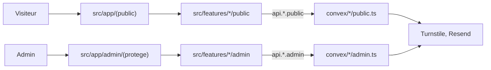

# Architecture

## Stack

- Next.js (App Router) + TypeScript + Tailwind CSS, hébergé sur Vercel. Pages publiques statiques, pour le SEO et les Core Web Vitals.
- Convex (région UE) : seul backend et seule base de données.
- Better Auth et Resend, chacun via son composant Convex. Cloudflare Turnstile contre les robots.
- shadcn/ui pour toute primitive UI : voir [design.md](design.md).
- pnpm. Les versions sont dans [INSTALL.md](../INSTALL.md) (Stack summary).

## Fonctionnement d'ensemble

## Décisions clés

- **[INSTALL.md](../INSTALL.md) est la référence.** Une décision qui le contredit le modifie d'abord, avec l'accord de Yanis.
- **Monolithe modulaire par feature × rôle** (`public` / `admin`) : un seul développeur, faible volume, et le rôle se lit dans les routes, les écrans et le backend. Disposition : [codebase-map.md](codebase-map.md).
- `src/app` choisit quelle page sert quelle URL, `src/features` décide ce qu'on voit et ce qu'on fait, `convex/` gère les données et qui a le droit.
- Les secrets vivent uniquement dans Convex. Le seul code serveur hors Convex est le relais `/api/auth` de Better Auth.
- **Code en anglais, URL en français.**
- **Code minimal.** Code explicite, aucune abstraction « magique ». Toute complexité ajoutée est justifiée et validée par Yanis avant d'être écrite.

## Règles d'import

Une règle non respectée = refus en revue.

1. `src/app/` importe uniquement depuis le `index.ts` d'une feature.
2. Une feature n'importe jamais les fichiers internes d'une autre feature.
3. `src/shared/` n'importe aucune feature.
4. Dans une feature, `public/` n'importe jamais `admin/`, et inversement.
5. Le front appelle le backend uniquement par `api.*`, jamais en important un fichier de `convex/`.
