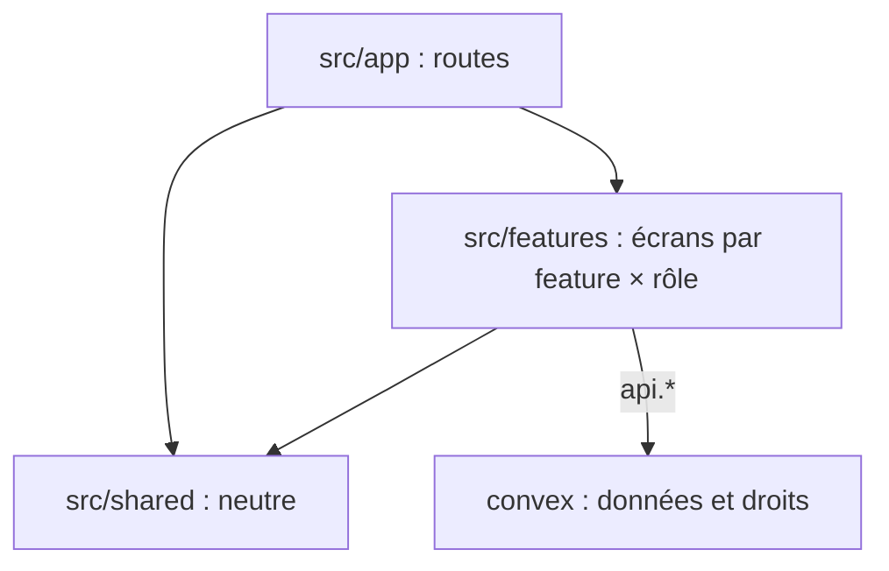

# Codebase Map

Existent : le scaffold (scope 3), soit `src/app/` (layout, page d'accueil provisoire dans `(public)/`, icônes) et `public/` (hero) ; puis `convex/` sans fonction (code généré, `tsconfig.json`) et `vercel.json` (scope 4) ; puis les tests et la CI (scope 5) : `convex/backend.test.ts`, `e2e/home.spec.ts`, `vitest.config.mts`, `playwright.config.ts`, `lighthouserc.js`, `.github/workflows/` (`ci.yml`, `lighthouse.yml`). Le reste de cette carte est la disposition validée, à suivre au fil des scopes. Arbre complet : [INSTALL.md](../INSTALL.md) (Folder structure).

## Zones

- `src/app/` : routes uniquement, fichiers fins. `(public)/` pour le visiteur, `admin/` pour le propriétaire, `api/auth/[...all]/` pour le relais Better Auth.
- `src/features/<feature>/{public,admin}/` : écrans d'une feature, rangés par rôle, exposés par `src/features/<feature>/index.ts`. Une feature à un seul rôle (`auth`) n'a pas de sous-dossier de rôle. Features : `auth`, `contact`, `newsletter`.
- `src/shared/` : ne connaît aucune feature. `ui/` (primitives shadcn/ui), `components/` (composants custom génériques, créé au premier besoin), `lib/utils.ts` (`cn`), `config/site.ts` (URL canonique, nom, lien Cal.com).
- `convex/<feature>/{public,admin}.ts` : fonctions ouvertes à tous, ou réservées au propriétaire. `contact/` ajoute `inbound.ts` (réception) et `emails.ts` (gabarits), `newsletter/` ajoute `emails.ts`.
- `convex/lib/` : `requireAdmin.ts`, `turnstile.ts`, `resend.ts`.
- `convex/betterAuth/` : composant Better Auth en Local Install.
- `e2e/` : tests Playwright. `.github/workflows/` : CI. Emplacement des autres tests : [testing.md](testing.md).
- `aidd_docs/` : `INSTALL.md`, `ROADMAP.md`, cette mémoire.
- `.claude/skills/`, `.agents/skills/`, `skills-lock.json` : skills Convex copiés par la CLI Convex (AI files).

## Points d'entrée

- `src/app/layout.tsx` : `<html>`, polices, Analytics, Speed Insights, provider Convex.
- `convex/convex.config.ts` : composants `betterAuth` et `resend`.
- `convex/http.ts` : routes HTTP, voir [api.md](api.md).
- `AGENTS.md` et `CLAUDE.md` finissent par le bloc `nextjs-agent-rules` (lire `node_modules/next/dist/docs/`). `next dev` le tient à jour dans `AGENTS.md` seulement : le recopier à l'identique dans `CLAUDE.md` quand il change.
- Puis par le bloc `convex-ai` (lire `convex/_generated/ai/guidelines.md`), écrit dans les deux fichiers et suivi par hash par la CLI Convex : ne pas l'éditer. Il cite `npx convex ai-files install` : à lancer en `pnpm exec`.
