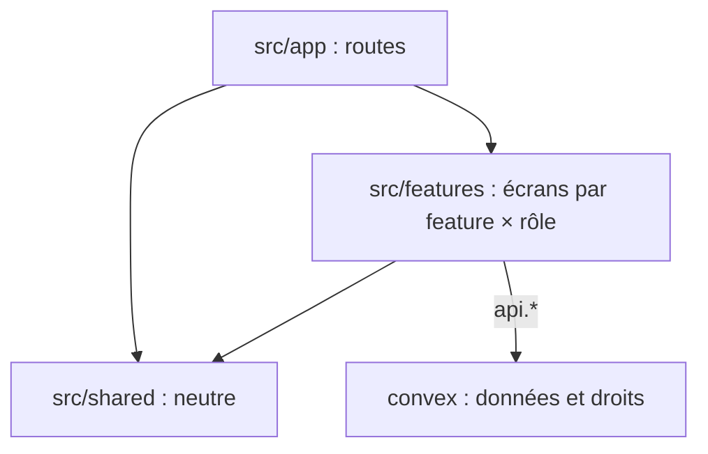

# Codebase Map

Aucun code à ce jour : cette carte est la disposition validée, à respecter dès le scaffold. Arbre complet : [INSTALL.md](../INSTALL.md) (Folder structure).

## Zones

- `src/app/` : routes uniquement, fichiers fins. `(public)/` pour le visiteur, `admin/` pour le propriétaire, `api/auth/[...all]/` pour le relais Better Auth.
- `src/features/<feature>/{public,admin}/` : écrans d'une feature, rangés par rôle, exposés par `src/features/<feature>/index.ts`. Une feature à un seul rôle (`auth`) n'a pas de sous-dossier de rôle. Features : `auth`, `contact`, `newsletter`.
- `src/shared/` : ne connaît aucune feature. `ui/` (primitives shadcn/ui), `components/` (composants custom génériques, créé au premier besoin), `lib/utils.ts` (`cn`), `config/site.ts` (URL canonique, nom, lien Cal.com).
- `convex/<feature>/{public,admin}.ts` : fonctions ouvertes à tous, ou réservées au propriétaire. `contact/` ajoute `inbound.ts` (réception) et `emails.ts` (gabarits), `newsletter/` ajoute `emails.ts`.
- `convex/lib/` : `requireAdmin.ts`, `turnstile.ts`, `resend.ts`.
- `convex/betterAuth/` : composant Better Auth en Local Install.
- `e2e/` : tests Playwright. `.github/workflows/` : CI. Emplacement des autres tests : [testing.md](testing.md).
- `aidd_docs/` : `INSTALL.md`, `ROADMAP.md`, cette mémoire.

## Points d'entrée

- `src/app/layout.tsx` : `<html>`, polices, Analytics, Speed Insights, provider Convex.
- `convex/convex.config.ts` : composants `betterAuth` et `resend`.
- `convex/http.ts` : routes HTTP, voir [api.md](api.md).
