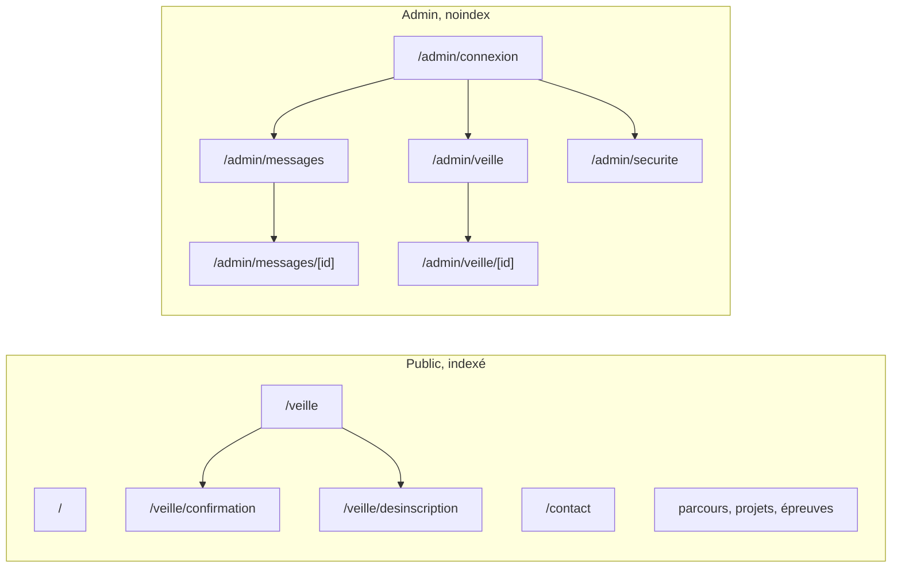

# Navigation

## Routage

- Next.js App Router. Les routes vivent dans `src/app/` et restent des fichiers fins qui importent l'`index.ts` d'une feature.
- `(public)/` : pages du visiteur, statiques et indexées. `sitemap.ts` et `robots.ts` à la racine de `src/app/`.
- `admin/` : jamais indexé (`noindex` dans son layout, `/admin` bloqué par `robots.ts`). Protection des pages : voir [auth.md](auth.md).

## Structure

