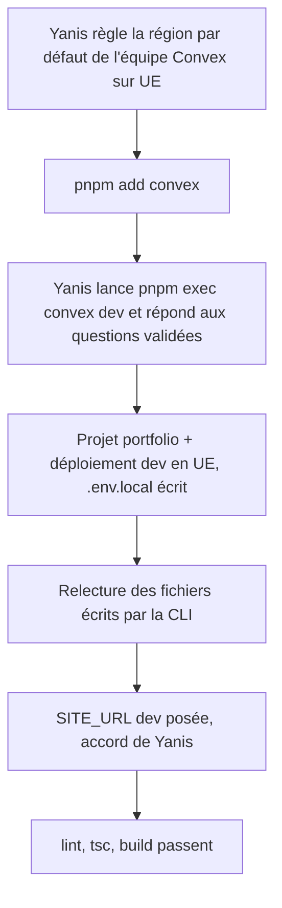
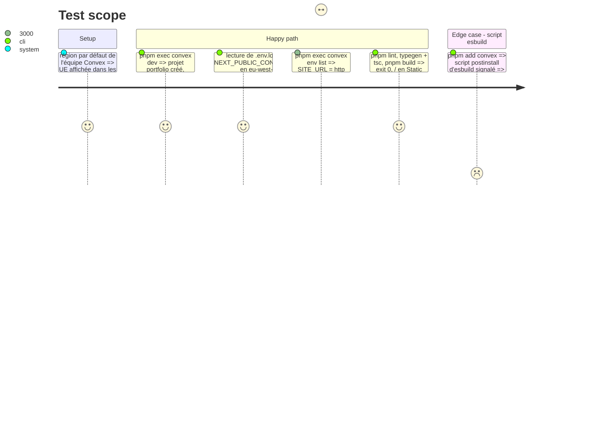

# Instruction: Backend Convex de dev

## Architecture projection

> Tree of the final files. ✅ create · ✏️ modify · ❌ delete

```txt
.
├── convex/
│   ├── _generated/                ✅ code généré par la CLI (api, server, dataModel) + ai/ (guidelines, état des AI files)
│   └── tsconfig.json              ✅ écrit par `convex dev`
├── .claude/skills/                ✅ skills Convex copiés par la CLI (Claude Code)
├── .agents/skills/                ✅ skills Convex copiés par la CLI (Codex)
├── skills-lock.json               ✅ écrit par la CLI `skills`
├── AGENTS.md                      ✏️ section Convex ajoutée par la CLI
├── CLAUDE.md                      ✏️ section Convex ajoutée par la CLI
├── eslint.config.mjs              ✏️ `convex/_generated/**` ignoré (ajout validé par Yanis en cours de phase)
├── package.json                   ✏️ `convex` 1.46.0 en dépendance, version exacte comme next et react
├── pnpm-lock.yaml                 ✏️
└── pnpm-workspace.yaml            ✏️ `allowBuilds` : `esbuild: false` (choix de Yanis)
```

`.env.local` est écrit par `convex dev` et reste hors Git. `convex/README.md`, exemple générique écrit par la CLI, n'est pas gardé.

Résultat : projet `portfolio` (équipe `black-rise`), déploiements dev `good-goshawk-727` et prod `valuable-seahorse-421`, tous deux en Europe (Ireland) d'après le dashboard ; l'URL d'un déploiement UE porte `eu-west-1`. Un premier projet, `portfolio-4231d`, était sorti en US East malgré le réglage : supprimé par Yanis puis recréé.

## User Journey



## Test Scope



## Tasks to do

### `1)` Région par défaut

> Garder dev, previews et prod en UE.

1. Yanis règle la région par défaut de l'équipe Convex sur `aws-eu-west-1` (paramètres de l'équipe, dashboard).

### `2)` Dépendance

> Rendre `pnpm exec convex` disponible au poste et au build Vercel.

1. `pnpm add convex@1.46.0 --save-exact`.
2. Script `postinstall` d'`esbuild` : proposition `false` dans `allowBuilds` (esbuild trouve son binaire par son paquet de plateforme), réponse de Yanis.

### `3)` Projet et déploiement dev

> Créer le projet `portfolio` et son déploiement dev, sans valeur par défaut.

1. `pnpm exec convex dev` lancé dans le panneau Terminal ; Yanis répond :

   | Question de la CLI | Réponse |
   | --- | --- |
   | What would you like to configure? (si posée) | create a new project |
   | Équipe (si plusieurs) | l'équipe de Yanis |
   | Project name | `portfolio` |
   | Use cloud or local dev deployment? (si posée) | cloud deployment |
   | Where should this dev deployment run? (si posée) | `aws-eu-west-1` (Europe) |
   | Set up Convex AI files? | Oui |

2. Arrêt du watcher (Ctrl+C) une fois « Convex functions ready ».

### `4)` Relecture

> Ne garder que ce qui est voulu.

1. Relire le diff de `CLAUDE.md` et `AGENTS.md` (blocs AIDD et Next.js intacts), les skills copiés, `convex/_generated/`.
2. Supprimer `convex/README.md`.

### `5)` Variable dev

> Origine du site en local.

1. Après accord : `pnpm exec convex env set SITE_URL http://localhost:3000`.

### `6)` Contrôles

1. `pnpm lint`, `pnpm exec next typegen && pnpm exec tsc --noEmit`, `pnpm build`.

## Test acceptance criteria

| Task | Acceptance criteria |
| ---- | ------------------- |
| 1 | La région par défaut de l'équipe est l'UE |
| 2 | `convex` 1.46.0 figure dans `dependencies`, l'installation passe sans avertissement de script non tranché |
| 3 | Le projet `portfolio` existe, son déploiement dev répond sur une URL `*.eu-west-1.convex.cloud`, `.env.local` est hors Git |
| 4 | Le diff ne contient que les fichiers listés, les blocs AIDD et Next.js de `CLAUDE.md` et `AGENTS.md` sont intacts |
| 5 | `SITE_URL` vaut `http://localhost:3000` sur le déploiement dev |
| 6 | Lint, types et build passent, `/` reste statique |
