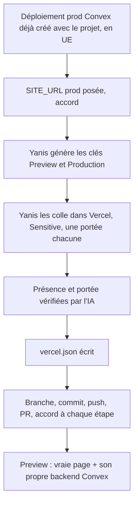
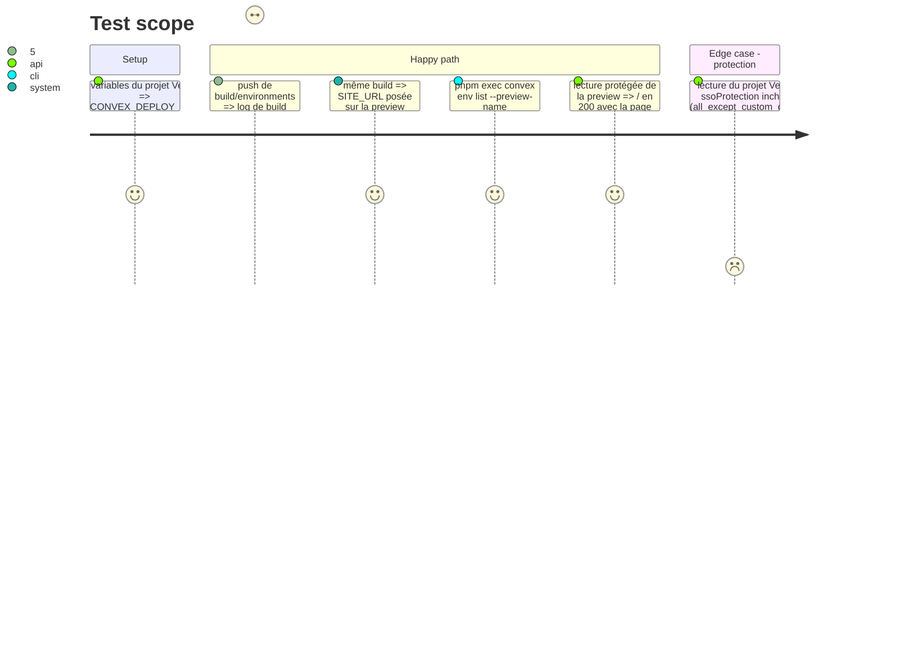

# Instruction: Previews et prod branchées

## Architecture projection

> Tree of the final files. ✅ create · ✏️ modify · ❌ delete

```txt
.
└── vercel.json                    ✅ preset Next.js, Build Command Convex, SITE_URL des previews
```

Contenu prévu :

```json
{
  "$schema": "https://openapi.vercel.sh/vercel.json",
  "framework": "nextjs",
  "buildCommand": "pnpm exec convex deploy --cmd 'pnpm run build' && if [ \"$VERCEL_ENV\" = preview ]; then pnpm exec convex env set --preview-name \"$VERCEL_GIT_COMMIT_REF\" SITE_URL \"https://$VERCEL_BRANCH_URL\"; fi"
}
```

## User Journey



## Test Scope



## Tasks to do

### `1)` Déploiement prod Convex

> Le backend de `main`, en UE.

1. Déploiement prod `valuable-seahorse-421` : déjà créé avec le projet, en Europe (Ireland) (vu dans le dashboard).
2. Après accord : `pnpm exec convex env set --prod SITE_URL https://yanis-harrat.com`.

### `2)` Clés de déploiement

> Chaque environnement Vercel pousse sur son propre backend.

1. Yanis génère la clé Preview (paramètres du projet) et la clé Production (paramètres du déploiement prod).
2. Yanis les ajoute dans Vercel sous `CONVEX_DEPLOY_KEY`, « Sensitive », l'une en Preview seule, l'autre en Production seule.
3. L'IA vérifie noms et portées par le MCP Vercel, sans lire les valeurs.

### `3)` Configuration Vercel

1. Écrire `vercel.json` (contenu ci-dessus).

### `4)` PR de test

> Une PR, accord de Yanis avant chaque action Git distante.

1. Branche `build/environments` depuis `main` à jour.
2. Commit `build: wire convex backends into vercel deployments` (phase 1, phase 2, plan).
3. Push et PR vers `main`, titre identique.

### `5)` Vérification de la preview

1. Log de build : preview Convex nommée d'après la branche, URL en `eu-west-1`, distincte de `good-goshawk-727`, `SITE_URL` posée.
2. `pnpm exec convex env list --preview-name build/environments`.
3. Page `/` servie par la preview (accès protégé par le MCP Vercel).
4. Protection des previews inchangée.

## Test acceptance criteria

| Task | Acceptance criteria |
| ---- | ------------------- |
| 1 | Le déploiement prod existe en UE et porte `SITE_URL = https://yanis-harrat.com` |
| 2 | Vercel a deux `CONVEX_DEPLOY_KEY`, sensibles, l'une limitée à Preview, l'autre à Production |
| 3 | `vercel.json` ne contient que le preset et la Build Command |
| 4 | La PR est ouverte depuis `build/environments` |
| 5 | La preview sert la vraie page et a son propre backend Convex en UE, avec `SITE_URL` égale à son URL de branche |
