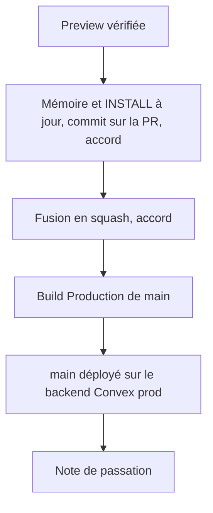
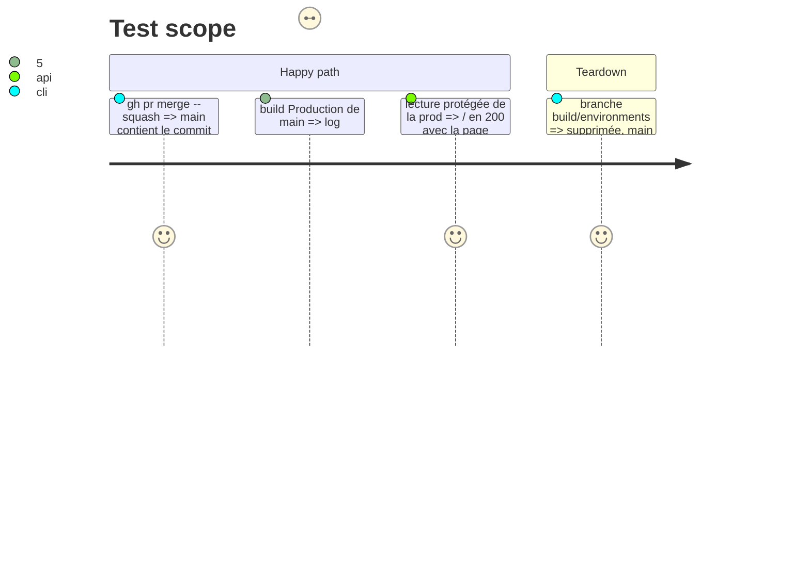

# Instruction: Mémoire, fusion et prod vérifiée

## Architecture projection

> Tree of the final files. ✅ create · ✏️ modify · ❌ delete

```txt
.
└── aidd_docs/
    ├── INSTALL.md                                    ✏️ Build Vercel validée, vercel.json et AI files dans Folder structure, risques preset et SITE_URL levés
    ├── memory/
    │   ├── deployment.md                             ✏️ Build Command dans vercel.json, SITE_URL des previews, clés posées, région UE par défaut
    │   ├── database.md                               ✏️ projet portfolio créé, déploiements dev et prod
    │   ├── codebase-map.md                           ✏️ convex/ et vercel.json existent, section Convex dans CLAUDE.md et AGENTS.md
    │   ├── project-brief.md                          ✏️ état : environnements en place (scope 4)
    │   └── coding-assertions.md                      ✏️ lancer en local : pnpm dev + pnpm exec convex dev
    └── tasks/2026_10/
        ├── 2026_10_15_scaffold/plan.md               ✏️ status: implemented
        ├── 2026_10_15_scaffold/phase-3.md            ✏️ status: done
        └── 2026_10_15_environments/                  ✏️ statuts
```

Hors dépôt : note `scope4-environnements-2026-10-15.md` dans le dossier de notes partagé.

## User Journey



## Test Scope



## Tasks to do

### `1)` Mémoire

> La mémoire décrit l'état réel après le scope.

1. Mettre à jour INSTALL.md et les fichiers de mémoire listés, avec les preuves de la phase 2.
2. Passer le plan du scaffold en `implemented` et sa phase 3 en `done` ; statuts de ce plan.
3. Commit `docs: record environments setup` sur la PR, push, après accord.

### `2)` Fusion

1. `gh pr merge --squash` après accord, branche supprimée, `main` local à jour.

### `3)` Prod

1. Log du build Production : déploiement Convex prod, différent de celui de la preview.
2. Page `/` servie par le déploiement Production.

### `4)` Passation

1. Écrire `scope4-environnements-2026-10-15.md` dans le dossier de notes partagé.

## Test acceptance criteria

| Task | Acceptance criteria |
| ---- | ------------------- |
| 1 | La mémoire ne contredit aucun réglage réel, le plan du scaffold est `implemented` |
| 2 | `main` contient le scope 4, la branche distante n'existe plus |
| 3 | `main` est déployé sur son propre backend Convex, la page est servie |
| 4 | La note de passation existe et liste réglages, preuves et suites |
