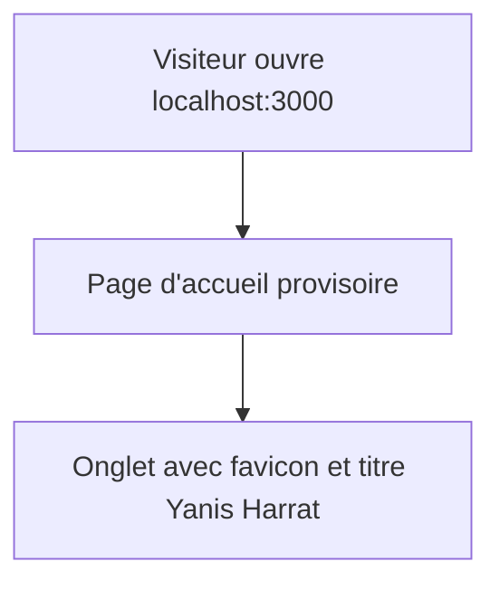
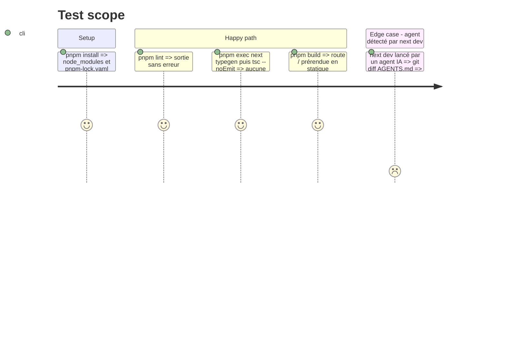

# Instruction: Scaffold et page provisoire

## Architecture projection

> Tree of the final files. ✅ create · ✏️ modify · ❌ delete

```txt
.
├── .gitignore                ✏️ version du générateur (Yanis)
├── AGENTS.md                 ✏️ bloc nextjs-agent-rules ajouté par next dev
├── CLAUDE.md                 ✏️ même bloc, recopié à la main
├── package.json              ✅ squelette de Yanis, react/react-dom 19.3.1
├── pnpm-lock.yaml            ✅ seul lockfile
├── pnpm-workspace.yaml       ✅ allowBuilds sharp/unrs-resolver à false
├── tsconfig.json             ✅ alias @/* → ./src/*
├── eslint.config.mjs         ✅ core-web-vitals + typescript
├── next.config.ts            ✅ reactCompiler, loader Tailwind Turbopack
├── public/
│   └── portfolio-hero.webp   ✅ repris
└── src/app/
    ├── layout.tsx            ✅ lang="fr", métadonnées, sans police
    ├── globals.css           ✅ @import "tailwindcss"
    ├── favicon.ico           ✅ repris
    ├── icon.png              ✅ repris
    ├── apple-icon.png        ✅ repris
    └── (public)/
        └── page.tsx          ✅ page d'accueil provisoire
```

## User Journey



## Test Scope



## Wireframe

```txt
┌──────────────────────────────┐
│ [1] Yanis Harrat             │
│ [2] Portfolio en construction│
└──────────────────────────────┘
1. Titre principal (h1)
2. Une ligne de texte
```

## Tasks to do

### `1)` Base

> Partir du squelette de Yanis sur `chore/scaffold`.

1. Branche `chore/scaffold` depuis `main` à `0139baf`, squelette repris tel quel.
2. `AGENTS.md` et `CLAUDE.md` remis comme sur `main`.

### `2)` Démo remplacée

> Ne garder que le socle et la page provisoire.

1. `src/app/(public)/page.tsx` : un `h1` et une ligne de texte.
2. `layout.tsx` : `lang="fr"`, titre et description, sans police Geist ; `globals.css` réduit à `@import "tailwindcss"`.
3. Icônes vers `src/app/`, hero vers `public/`, depuis `portfolio-kept-2026-10-15/`.
4. `pnpm add react@19.3.1 react-dom@19.3.1`.

### `3)` Bloc Next.js

> Garder la consigne Next.js dans les deux fichiers de contexte.

1. `pnpm dev` lancé par l'agent : `next dev` écrit le bloc en fin d'`AGENTS.md`.
2. Bloc recopié à l'identique en fin de `CLAUDE.md` ; `update_memory.js` relancé, les deux blocs restent.

## Test acceptance criteria

| Task | Acceptance criteria |
| ---- | ------------------- |
| 1 | Branche basée sur `0139baf` ; `AGENTS.md` et `CLAUDE.md` sans ligne retirée par rapport à `main` |
| 2 | La page affiche « Yanis Harrat » en `lang="fr"` ; favicon, icônes et hero en 200 ; plus de SVG de démo ni de police |
| 3 | Le même bloc figure en fin d'`AGENTS.md` et de `CLAUDE.md` |
