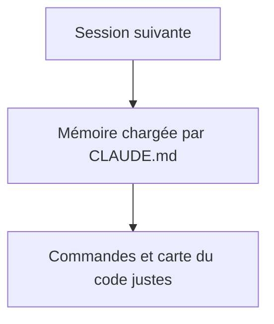
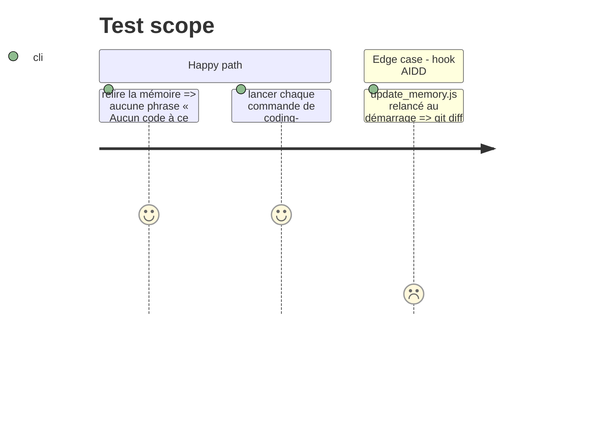

# Instruction: Mémoire et note de passation

## Architecture projection

> Tree of the final files. ✅ create · ✏️ modify · ❌ delete

```txt
.
└── aidd_docs/
    ├── INSTALL.md                     ✏️ Tailwind par @tailwindcss/turbopack sans postcss.config.mjs, React Compiler activé, Cache Components désactivé
    └── memory/
        ├── coding-assertions.md       ✏️ commandes réelles : install, dev, lint, typecheck, build
        ├── codebase-map.md            ✏️ « Aucun code à ce jour » retiré, état réel du dépôt, bloc Next.js dans AGENTS.md et CLAUDE.md
        └── project-brief.md           ✏️ « Aucun code à ce jour » remplacé par l'état réel
```

`testing.md` reste tel quel : « Aucun test à ce jour » est toujours vrai, les tests arrivent au scope 5. La note `scope3-scaffold-2026-10-15.md` va dans le dossier de notes partagé, hors du dépôt.

## User Journey



## Test Scope



## Tasks to do

### `1)` Mémoire

> Refléter le dépôt réel, sans toucher aux décisions validées.

1. `coding-assertions.md` : commandes `pnpm install`, `pnpm dev`, `pnpm lint`, `pnpm exec next typegen && pnpm exec tsc --noEmit`, `pnpm build`.
2. `codebase-map.md` : état actuel (scaffold, pas encore de `features/`, `shared/`, `convex/`) et une ligne sur le bloc Next.js (tenu par `next dev` dans `AGENTS.md`, copie manuelle dans `CLAUDE.md`).
3. `project-brief.md` : phrase d'état mise à jour.
4. `INSTALL.md` : Stack summary (`@tailwindcss/turbopack`, React Compiler, Cache Components désactivé), Folder structure (plus de `postcss.config.mjs`), risque « pnpm sur Vercel » complété, risque « ESLint 9 non supporté » ajouté.

### `2)` Passation

> Laisser le contexte utile aux scopes 4 à 6.

1. Écrire `scope3-scaffold-2026-10-15.md` : versions installées, décisions, comportement observé de la preview Vercel, points pour le scope 4 (preset Next.js, version de pnpm sur Vercel).

## Test acceptance criteria

| Task | Acceptance criteria |
| ---- | ------------------- |
| 1 | La mémoire ne contredit plus le dépôt ; chaque commande citée passe |
| 2 | La note existe dans le dossier partagé et nomme les points ouverts du scope 4 |
