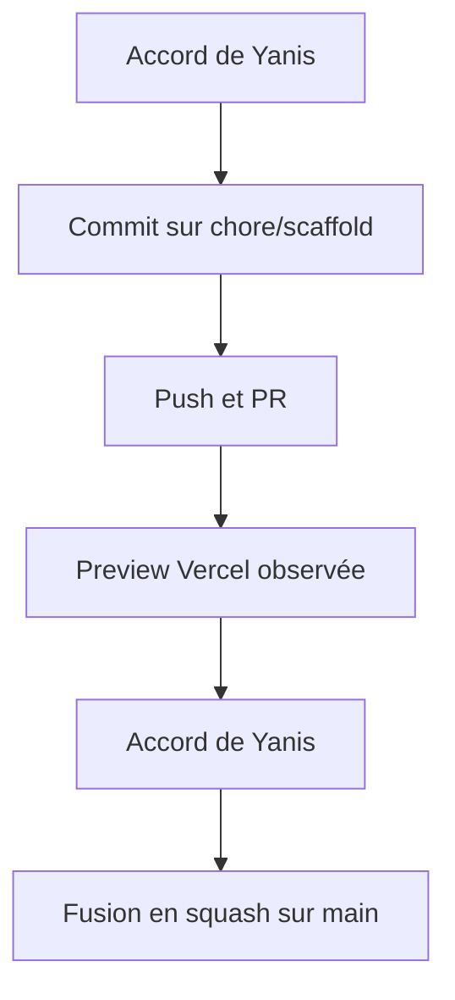
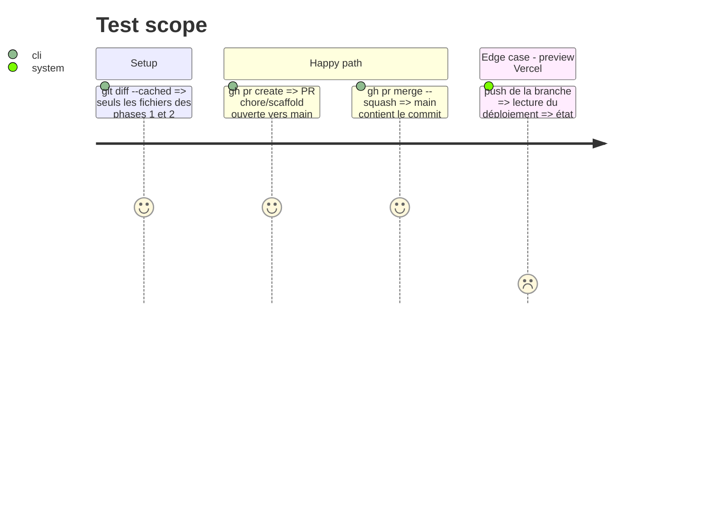

# Instruction: Livraison (commit, PR, merge)

## Architecture projection

> Tree of the final files. ✅ create · ✏️ modify · ❌ delete

```txt
.
└── (aucun fichier : commit, PR et fusion des phases 1 et 2, plans compris)
```

## User Journey



## Test Scope



## Tasks to do

### `1)` Commit

> Un commit propre, avec l'accord de Yanis.

1. Vérifier l'index (le hook AIDD peut indexer des fichiers de mémoire).
2. `chore: scaffold next.js app with pnpm`, après accord.

### `2)` PR

> Ouvrir la PR, avec l'accord de Yanis.

1. Push de `chore/scaffold`, PR vers `main`, titre = message du squash.
2. Relever l'état de la preview Vercel (lecture seule) et le noter dans la PR et la passation.

### `3)` Fusion

> Fusionner en squash, avec l'accord de Yanis.

1. `gh pr merge --squash`, branche supprimée, `main` local mis à jour.

## Test acceptance criteria

| Task | Acceptance criteria |
| ---- | ------------------- |
| 1 | Le commit ne contient que les fichiers prévus |
| 2 | La PR est ouverte, l'état de la preview est connu |
| 3 | `main` contient le scaffold, la branche distante n'existe plus |
