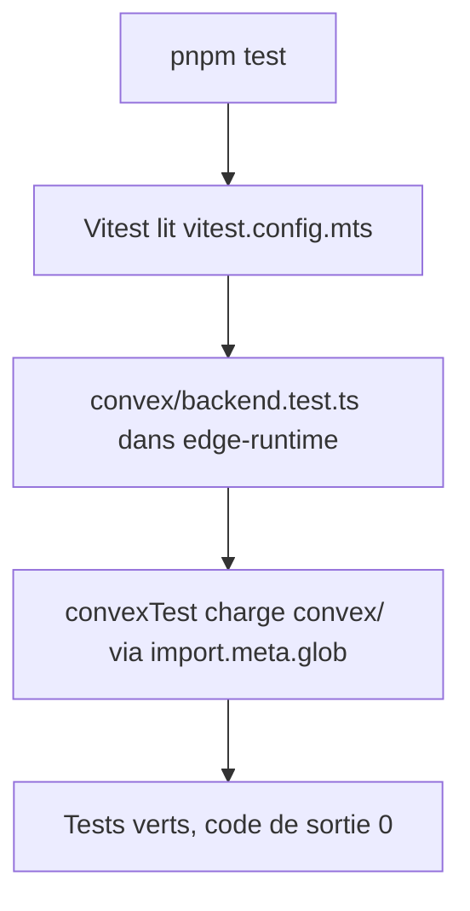
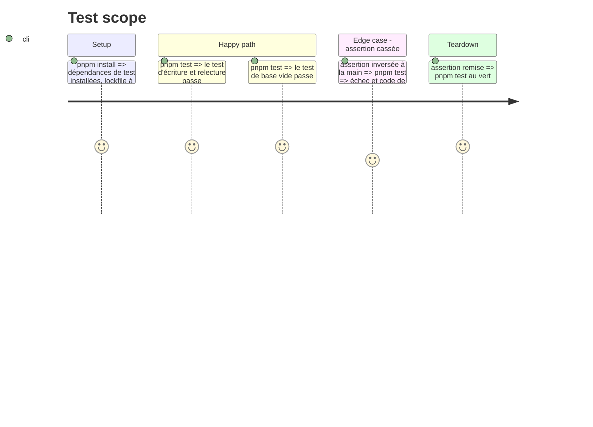

# Instruction: Vitest et convex-test

## Architecture projection

> Tree of the final files. ✅ create · ✏️ modify · ❌ delete

```txt
.
├── convex/
│   └── backend.test.ts        ✅ exemple d'intégration : écrire et relire, base vide à chaque test
├── vitest.config.mts          ✅ environnement edge-runtime, tests de convex/ uniquement (.mts : syntaxe ESM sans "type": "module")
├── package.json               ✏️ vitest, vite, convex-test, @edge-runtime/vm, @types/node 24, script test
├── pnpm-lock.yaml             ✏️ dépendances ajoutées
└── pnpm-workspace.yaml        ✏️ seulement si un nouveau paquet a un script d'installation (tranché avec Yanis)
```

## User Journey



## Test Scope



## Tasks to do

### `1)` Dépendances

> Les outils de test sont installés, sans script d'installation non tranché.

1. `pnpm add -D vitest vite convex-test @edge-runtime/vm`.
2. `pnpm add -D @types/node@^24`.
3. Si pnpm signale un script d'installation : demander à Yanis `true` ou `false` dans `allowBuilds`.
4. Aucun avertissement de dépendance pair restant.

### `2)` Configuration

> Vitest teste `convex/` dans l'environnement du runtime Convex.

1. `vitest.config.mts` : `include: ["convex/**/*.test.ts"]`, `environment: "edge-runtime"`.
2. Script `"test": "vitest run"` dans `package.json`.

### `3)` Exemple d'intégration

> Le premier test montre comment écrire un test Convex.

1. `convex/backend.test.ts` : `/// <reference types="vite/client" />`, `convexTest(undefined, import.meta.glob("./**/*.ts"))`.
2. Test 1 : un document écrit avec `t.run` se relit.
3. Test 2 : un nouveau `convexTest` démarre sans le document du précédent.
4. Vérifier qu'une assertion cassée fait échouer `pnpm test`, puis la remettre.

### `4)` Contrôles locaux

1. `pnpm lint`, `pnpm exec next typegen && pnpm exec tsc --noEmit`, `pnpm build` à exit 0.
2. Le test n'est pas poussé dans Convex : vérifié au build de la preview (phase 3), sans pousser sur le déploiement dev.

## Test acceptance criteria

| Task | Acceptance criteria |
| ---- | ------------------- |
| 1 | `package.json` liste les 5 paquets, l'installation ne signale ni script d'installation non tranché ni dépendance pair manquante |
| 2 | `pnpm test` lance Vitest une fois et rend la main, sans mode surveillance |
| 3 | Les deux tests passent ; une assertion cassée rend `pnpm test` rouge |
| 4 | Lint, types et build restent verts |
