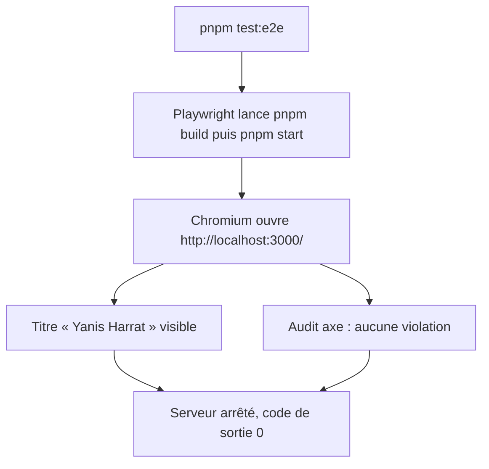
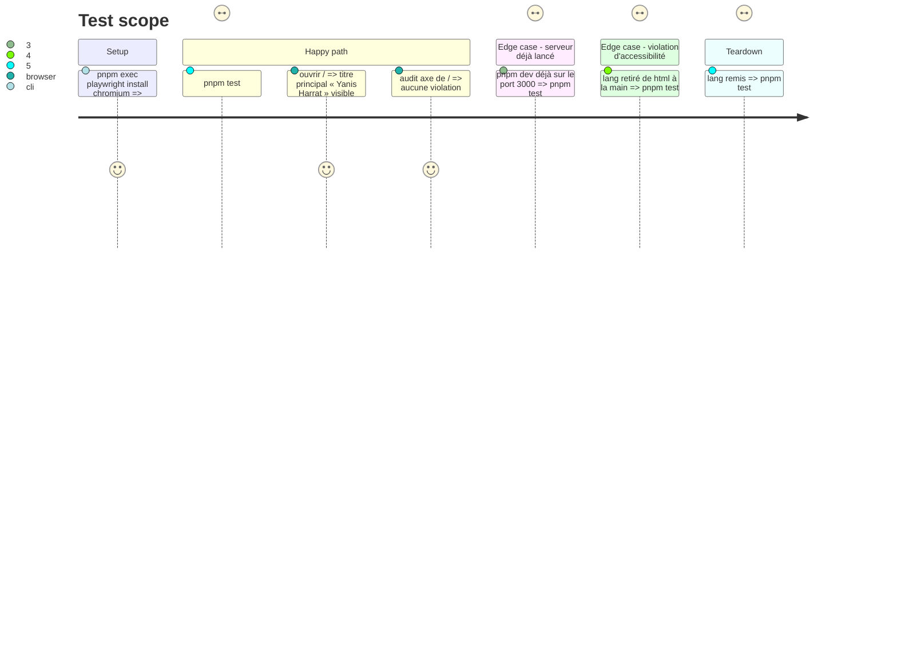

# Instruction: E2E Playwright et axe sur le poste

## Architecture projection

> Tree of the final files. ✅ create · ✏️ modify · ❌ delete

```txt
.
├── e2e/
│   └── home.spec.ts           ✅ page d'accueil : titre visible, aucune violation axe
├── playwright.config.ts       ✅ Chromium, build de production local sur le port 3000
├── package.json               ✏️ @playwright/test, @axe-core/playwright, script test:e2e
├── pnpm-lock.yaml             ✏️ dépendances ajoutées
└── .gitignore                 ✏️ test-results/, playwright-report/, blob-report/, playwright/.cache/
```

Hors dépôt : Chromium de Playwright dans `~/Library/Caches/ms-playwright` (téléchargement accordé par Yanis).

## User Journey



## Test Scope



## Tasks to do

### `1)` Dépendances et navigateur

> Playwright et axe sont installés, Chromium est disponible.

1. `pnpm add -D @playwright/test @axe-core/playwright` (script d'installation éventuel tranché avec Yanis).
2. Avec l'accord de Yanis : `pnpm exec playwright install chromium`.

### `2)` Configuration

> `pnpm test:e2e` teste toujours un build de production local.

1. `playwright.config.ts` : `testDir: "e2e"`, un projet Chromium, `baseURL` `http://localhost:3000`, `webServer` `pnpm build && pnpm start` sans réutiliser un serveur existant.
2. Script `"test:e2e": "playwright test"`.
3. `.gitignore` : sorties de Playwright.

### `3)` Exemple E2E + axe

> La page d'accueil est vérifiée comme un visiteur la voit.

1. `e2e/home.spec.ts` : le titre principal « Yanis Harrat » est visible.
2. Même fichier : `AxeBuilder` sur `/`, liste des violations vide.
3. Vérifier que `lang` retiré rend le test axe rouge, puis le remettre.

### `4)` Contrôles locaux

1. `pnpm test:e2e` vert ; `pnpm lint` et `tsc` verts ; Vitest n'exécute pas `e2e/`.

## Test acceptance criteria

| Task | Acceptance criteria |
| ---- | ------------------- |
| 1 | Les deux paquets sont dans `package.json`, Chromium se lance |
| 2 | `pnpm test:e2e` construit, démarre puis arrête le serveur seul ; un serveur déjà lancé sur le port 3000 fait échouer avec un message clair |
| 3 | Les deux tests passent ; une violation d'accessibilité fait échouer le test axe en nommant la règle |
| 4 | Lint, types et Vitest restent verts, sans lancer les E2E |
