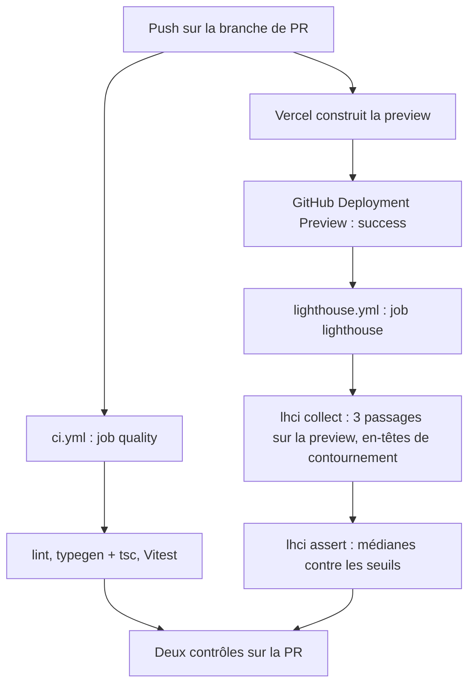
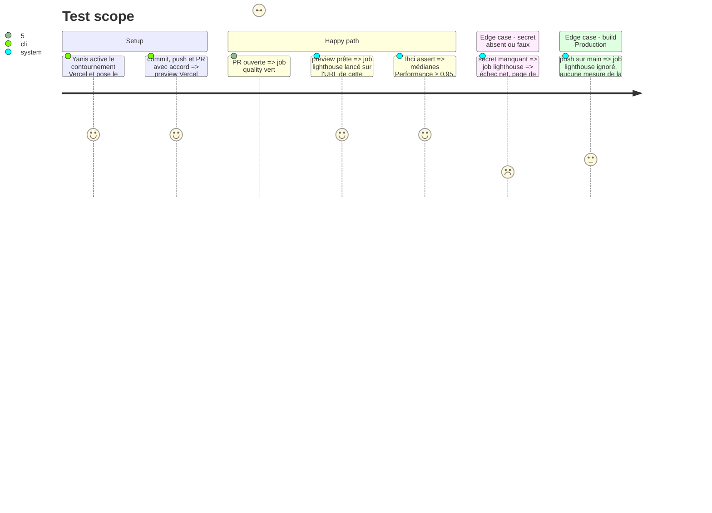

# Instruction: CI GitHub Actions et Lighthouse sur la preview

## Architecture projection

> Tree of the final files. ✅ create · ✏️ modify · ❌ delete

```txt
.
├── .github/
│   └── workflows/
│       ├── ci.yml             ✅ job quality sur chaque PR : lint, typegen + tsc, Vitest
│       └── lighthouse.yml     ✅ job lighthouse quand la preview Vercel est prête
├── lighthouserc.js            ✅ URL de la preview, 3 passages, médiane, seuils, en-têtes, is-crawlable ignoré
├── package.json               ✏️ @lhci/cli
├── pnpm-lock.yaml             ✏️ dépendance ajoutée
└── .gitignore                 ✏️ .lighthouseci/
```

Hors dépôt, faits par Yanis : « Protection Bypass for Automation » activée sur le projet Vercel `portfolio`, secret GitHub `VERCEL_AUTOMATION_BYPASS_SECRET` (il colle le secret lui-même).

## User Journey



## Test Scope



## Tasks to do

### `1)` Workflow `quality`

> Chaque PR est vérifiée sur un clone neuf.

1. `.github/workflows/ci.yml` : `on: pull_request`, `permissions: contents: read`, annulation des runs dépassés de la même branche.
2. Job `quality`, `ubuntu-latest` : checkout (sans garder le jeton), pnpm (version lue dans `packageManager`), Node 24 avec cache pnpm, `pnpm install --frozen-lockfile`.
3. Étapes : `pnpm lint`, `pnpm exec next typegen && pnpm exec tsc --noEmit`, `pnpm test`.
4. Actions épinglées par SHA de leur dernière version, version en commentaire.

### `2)` Lighthouse CI

> La preview de chaque PR est mesurée dans les conditions réelles de Vercel.

1. `pnpm add -D @lhci/cli` (script d'installation éventuel tranché avec Yanis).
2. `lighthouserc.js` : URL lue dans l'environnement, `numberOfRuns: 3`, `extraHeaders` `x-vercel-protection-bypass` + `x-vercel-skip-toolbar`, `skipAudits: ["is-crawlable"]`, assertions `error` en `median` : Performance 0,95, SEO, Accessibilité, Bonnes pratiques 1. Aucune section `upload`.
3. `.github/workflows/lighthouse.yml` : `on: deployment_status`, job `lighthouse` seulement si `state == 'success'` et `environment == 'Preview'`, mêmes étapes d'installation, puis `pnpm exec lhci collect` et `pnpm exec lhci assert` avec l'URL `environment_url` et le secret passés par `env`.
4. `.gitignore` : `.lighthouseci/`.

### `3)` Contournement de la protection

> Lighthouse entre sur la preview sans qu'aucun secret ne passe par l'IA.

1. Yanis active « Protection Bypass for Automation » dans Vercel (projet `portfolio`, Settings, Deployment Protection) et copie le secret.
2. Yanis lance `gh secret set VERCEL_AUTOMATION_BYPASS_SECRET` et colle le secret.
3. Vérification : `gh secret list` montre le nom ; capture de la page Deployment Protection.

### `4)` PR

1. Contrôles locaux verts (lint, types, Vitest, build, E2E).
2. Avec l'accord de Yanis : commit, push de `ci/test-pipeline`, PR `ci: add test suites and lighthouse checks`.
3. Les deux jobs passent sur la PR ; le log du build Vercel de la preview ne pousse aucun fichier de test dans Convex.

## Test acceptance criteria

| Task | Acceptance criteria |
| ---- | ------------------- |
| 1 | La PR affiche le contrôle `quality` vert, lancé sur un clone neuf |
| 2 | La PR affiche le contrôle `lighthouse` vert, mesuré sur l'URL de sa propre preview, médiane de 3 passages, aucun rapport publié |
| 3 | Le secret existe côté Vercel et côté GitHub, sa valeur n'apparaît dans aucun fichier ni journal |
| 4 | La PR est ouverte avec ses deux contrôles verts, la preview a son backend Convex sans fichier de test |
