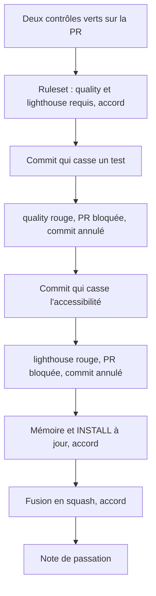
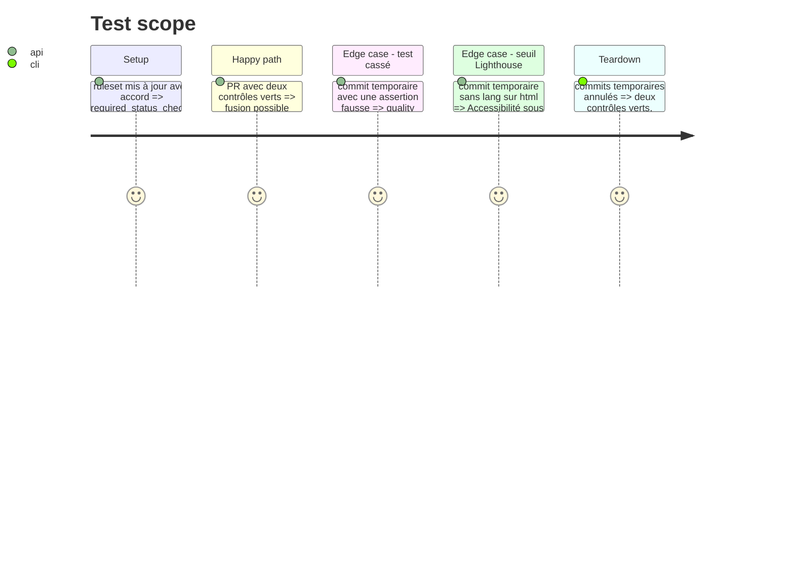

# Instruction: Contrôles requis, démonstration, mémoire, fusion

## Architecture projection

> Tree of the final files. ✅ create · ✏️ modify · ❌ delete

```txt
.
└── aidd_docs/
    ├── INSTALL.md                          ✏️ Stack summary (versions de test), Testing (déclencheur, en-têtes, is-crawlable, pas de rapport), risques levés ou ajoutés
    ├── memory/
    │   ├── testing.md                      ✏️ tests existants, emplacement, niveau unitaire reporté au scope 10, exemple remplacé au scope 7
    │   ├── coding-assertions.md            ✏️ commandes pnpm test, pnpm test:e2e, installation de Chromium
    │   ├── vcs.md                          ✏️ contrôles requis quality et lighthouse dans le ruleset
    │   ├── deployment.md                   ✏️ contournement Vercel actif, secret GitHub posé, workflows
    │   ├── codebase-map.md                 ✏️ fichiers de test et workflows existants
    │   └── project-brief.md                ✏️ état : tests et CI en place (scope 5)
    └── tasks/2026_10/2026_10_16_tests-ci/  ✏️ statuts
```

Hors dépôt : ruleset `main` (id 25186980) avec la règle `required_status_checks` ; note `scope5-tests-ci-<date>.md` dans le dossier de notes partagé.

## User Journey



## Test Scope



## Tasks to do

### `1)` Contrôles requis

> `main` refuse une PR dont un contrôle est rouge ou absent.

1. Relire le ruleset (GET), puis, avec l'accord de Yanis, le remplacer (PUT) en gardant ses règles et en ajoutant `required_status_checks` : `quality` et `lighthouse`, application GitHub Actions, sans exiger une branche à jour.
2. Relire le ruleset : la règle est présente, les autres sont inchangées.

### `2)` Démonstration

> La preuve qu'une PR qui casse un test ou un seuil est bloquée.

1. Avec accord : commit temporaire qui casse une assertion de `convex/backend.test.ts`, push. Preuve : `quality` rouge, `gh pr view --json mergeStateStatus` = `BLOCKED`. Annuler par un commit.
2. Avec accord : commit temporaire qui retire `lang="fr"`, push. Preuve : `lighthouse` rouge (Accessibilité < 1), `BLOCKED`. Annuler par un commit.
3. Les deux contrôles redeviennent verts.

### `3)` Mémoire

> La mémoire décrit l'état réel après le scope.

1. Mettre à jour INSTALL et les fichiers de mémoire listés, avec les preuves.
2. Statuts du plan et des phases.
3. Commit `docs: record test and ci setup` sur la PR, push, après accord.

### `4)` Fusion et passation

1. Avec accord : `gh pr merge --squash`, branche supprimée, `main` local à jour.
2. Écrire `scope5-tests-ci-<date>.md` dans le dossier de notes partagé.

## Test acceptance criteria

| Task | Acceptance criteria |
| ---- | ------------------- |
| 1 | Le ruleset exige `quality` et `lighthouse`, ses autres règles n'ont pas changé |
| 2 | Un test cassé et un seuil Lighthouse raté rendent chacun la PR non fusionnable, preuve à l'appui |
| 3 | La mémoire ne contredit aucun réglage réel |
| 4 | `main` contient le scope 5, la branche distante n'existe plus, la note de passation existe |
